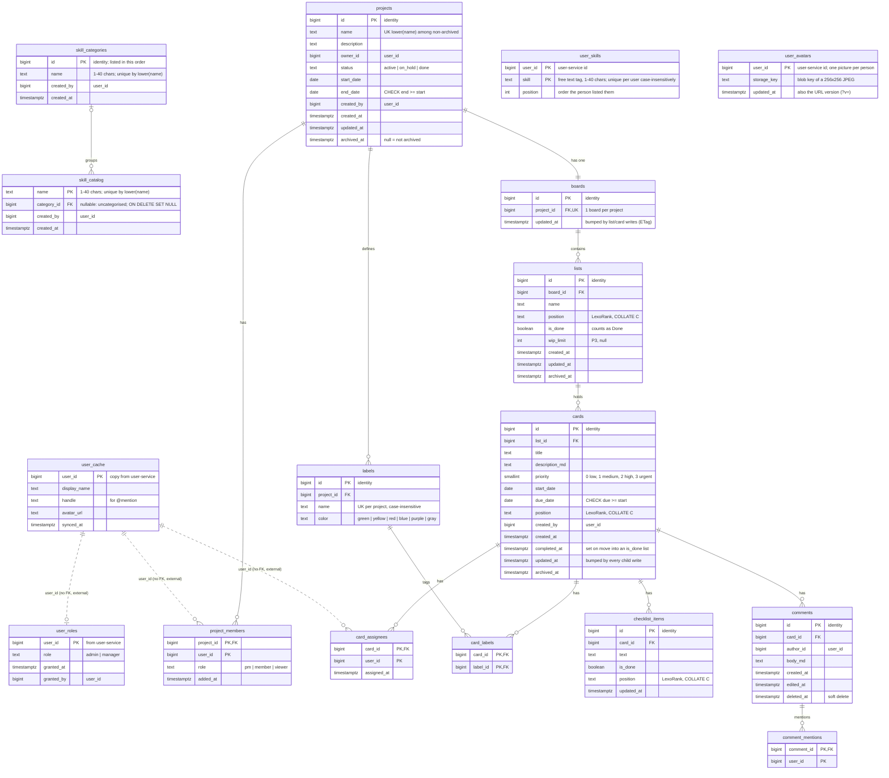
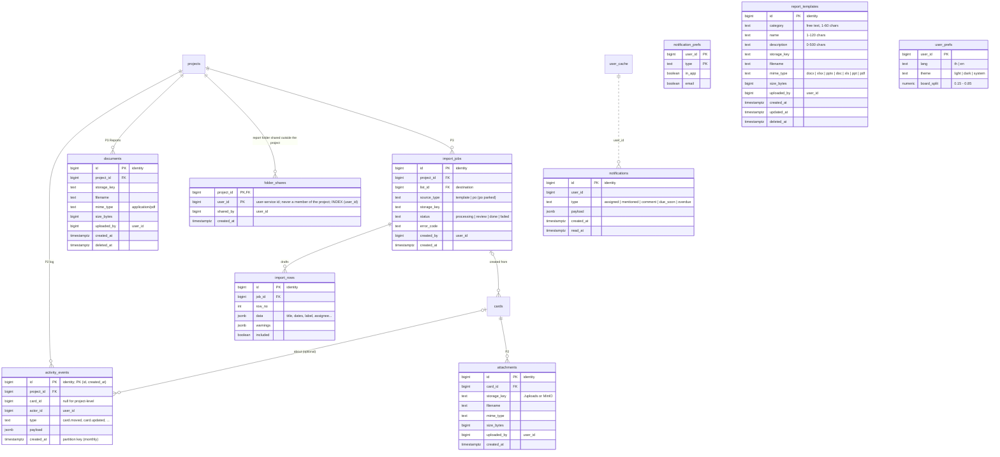

# Project Tracking: ERD (proposal)

PostgreSQL, schema `tracking`, owned only by `tracking-service`. Status: **proposal**, not yet migrated. The runnable DDL for the tables the code uses today is [backend/db/schema.sql](../backend/db/schema.sql).

**Single department (decided 2026-11-17):** there is no Workspace level. Projects sit at the top, and the only roles above project level are in `user_roles`.

## P1: core (build first)



## P2 / P3: later phases (same schema, added by later migrations)



## Rules the diagram cannot show

- **Keys:** `bigint GENERATED ALWAYS AS IDENTITY`. Integer keys are enough for one department. They are `bigint` rather than `int` because sqlc maps `bigint` to Go `int64`, the type the Go code uses everywhere. `int` would need `int32` conversions.
- **Optimistic create:** the database assigns the id, so the frontend shows a new card with a temporary client id and replaces it with the real id from the response.
- **Users are external:** every column that points at a person (`user_id`, `owner_id`, `created_by`, `author_id`, ...) holds the user-service id. There is no FK and no users table. Names and avatars come from `user_cache`. user-service ids are integers (confirmed 2026-11-17). These columns are `bigint`, which holds any `int` value, and it matches the `int64` the Go code already uses.
- **Roles above project level:** `user_roles` holds only the exceptions. `admin` can do everything, including managing `user_roles`. `manager` can create projects and becomes PM of each one it creates. A user with no row is a regular user, who sees only the projects listed for them in `project_members`. One role per user (`user_id` is the PK).
- **Project roles are separate:** `project_members.role` (`pm | member | viewer`) is not a reference to `user_roles`. It is its own value with a CHECK.
- **Enums:** `text` + `CHECK (... IN (...))` for values with no order (`status`, `role`, `color`, `type`). The value can be read directly in the database, logs and API, and adding a value is a cheap migration. `priority` is the exception: `smallint CHECK (priority BETWEEN 0 AND 3)`, because it has an order and `ORDER BY priority DESC` sorts it directly. The API sends the names `low | medium | high | urgent`, never the numbers.
- **Archive is not a status:** `projects.status` is the work state (`active | on_hold | done`). `archived_at` alone says whether a project is archived, so the two can never disagree.
- **Board load joins lists:** `cards` has no `board_id`. A board loads with `cards JOIN lists ON lists.id = cards.list_id WHERE lists.board_id = $1`, using the indexes on `lists (board_id)` and `cards (list_id, position)`.
- **Same-project rule:** `card_labels` must join a label from the card's own project. The service checks this, because the database cannot enforce it without `project_id` on `cards`.
- **Board load selects only what the board shows:** title, priority, dates, `completed_at`, labels, assignees, checklist and comment counts. `description_md` and comment bodies load when a card is opened. Card children load as one query per child table for the whole board (`WHERE card_id IN (...)`), never one query per card.
- **Ordering:** `position text COLLATE "C"`.
  - The unique indexes on positions skip archived rows (`WHERE archived_at IS NULL`): an archived card keeps its old key, and a new key computed between visible neighbours could otherwise collide with it.
  - Unarchiving a card or list gives it a new key at the end of its list or board.
  - Checklist items have no archive, so `UNIQUE (card_id, position)` covers all of them.
- **Completion:** `cards.completed_at` is set when a card moves into a list with `is_done = true`, and cleared when it moves out, in the same transaction as the move. Done, overdue, "done this week" and the Gantt read it from `cards` alone, with no join to `lists`.
- **"Today" is Bangkok time:** the database runs with `ALTER DATABASE ... SET timezone = 'Asia/Bangkok'`, so `current_date` matches the user's day. Without it, a UTC server shows a card due yesterday as not yet overdue between 00:00 and 07:00 Thai time.
- **Search:** `ILIKE '%term%'` on `title` (and `description_md` when asked), limited to the projects the caller can see. There is no `tsvector`: PostgreSQL has no Thai word splitter, so `ออกแบบหน้าแรก` would be one token and `หน้าแรก` would not match it.
  - At one department's size (thousands of cards) the scan takes milliseconds.
  - Add a `pg_trgm` GIN index only if `EXPLAIN ANALYZE` shows search over budget. First check `SELECT show_trgm('ออกแบบหน้าแรก')`: Thai vowel and tone marks must not split the trigrams under the database locale.
- **Uniqueness:**
  - `boards.project_id` is UNIQUE.
  - Project names are unique ignoring case, but only among projects that are not archived. A new project can reuse the name of an archived one.
  - Label names are unique per project, ignoring case.
- **ETag:**
  - Every write to a card's children (assignee, label, checklist, comment) bumps `cards.updated_at` in the same transaction.
  - Every write that changes what the board shows bumps `boards.updated_at`. That covers lists, cards, assignees, card labels, checklist items, comments, project labels and members.
  - The ETag hashes `boards.updated_at` with the caller's role.
- **Archive, never purge:**
  - `archived_at` and `deleted_at` hide rows. Nobody hard-deletes a project, so all history stays for audit.
  - FKs from a project down to card children use the default `ON DELETE NO ACTION`, so an accidental `DELETE` fails instead of cascading.
  - Join rows are the exception: removing an assignee, a card label, a project member or a mention deletes that row.
- **Retention and growth:**
  - `activity_events` are kept forever, partitioned by month on `created_at`. A partitioned table needs the partition key in its PK, so the PK is `(id, created_at)`.
  - `activity_events.payload` holds only what changed, as ids and values (`{"from_list":12,"to_list":14}`). It never holds names, titles or whole-row snapshots. Names come from current rows at read time.
  - Size estimate for `activity_events`: 20 users × 50 events a day × 250 working days ≈ 250,000 rows a year, at about 300 bytes each with indexes. That is under 100 MB a year.
  - `notifications` older than 1 year are deleted by a daily background job.
  - `import_rows` are drafts. They are deleted when their job reaches `done`. Rows of a `failed` job are deleted after 7 days. The `import_jobs` row stays as the record. The uploaded file is deleted with its rows.
  - Files live outside the database (`./uploads`, MinIO later). The database stores only metadata.
- **Size limits:** text columns have `CHECK (char_length(...) <= n)`: card and project title 200, `description_md` 20,000, comment body 5,000, checklist text 500. These are defaults: change them in one migration if users need more. The service validates the same limits first, so the user gets a clear message instead of a constraint error.
- **Dates:**
  - Every timestamp column is `timestamptz`.
  - `end_date >= start_date` and `due_date >= start_date` are CHECK constraints in the database as well as in the service.

## Indexes (from the performance skill)

Only indexes that a screen's query uses. Each one costs space and slows every write, so do not add one without an `EXPLAIN` that needs it. `projects` has no `status` index: a department has few projects, and a sequential scan is faster.

```sql
CREATE UNIQUE INDEX ON projects (lower(name)) WHERE archived_at IS NULL;
CREATE INDEX ON project_members (user_id);                       -- "my projects", permission check
CREATE UNIQUE INDEX ON lists (board_id, position)
  WHERE archived_at IS NULL;                                     -- board load + order
CREATE UNIQUE INDEX ON cards (list_id, position)
  WHERE archived_at IS NULL;                                     -- board load + order + LexoRank gap
CREATE INDEX ON cards (due_date)
  WHERE archived_at IS NULL AND completed_at IS NULL;            -- overdue / due soon, dashboard
CREATE INDEX ON card_assignees (user_id);                        -- My Tasks, workload
CREATE UNIQUE INDEX ON labels (project_id, lower(name));
CREATE UNIQUE INDEX ON checklist_items (card_id, position);      -- also serves "items of a card"
CREATE INDEX ON comments (card_id) WHERE deleted_at IS NULL;
CREATE INDEX ON activity_events (project_id, created_at DESC);   -- P2, created on each partition
CREATE INDEX ON notifications (user_id, created_at DESC);        -- P2, notification list
CREATE INDEX ON notifications (user_id) WHERE read_at IS NULL;   -- P2, unread badge
CREATE INDEX ON notifications (created_at);                      -- P2, daily 1-year cleanup
CREATE INDEX idx_report_templates_live ON report_templates (lower(category), lower(name), id) WHERE deleted_at IS NULL; -- Reports > Templates list
CREATE UNIQUE INDEX ux_user_skills ON user_skills (user_id, lower(skill)); -- one spelling per tag per person; the PK (user_id, skill) alone lets "Go" and "go" both in
CREATE UNIQUE INDEX ux_skill_catalog ON skill_catalog (lower(name)); -- the department list: "Go" and "go" are one skill
CREATE UNIQUE INDEX ux_skill_categories_name ON skill_categories (lower(name)); -- "Network" and "network" are one category
```

## Business decisions (2026-11-17)

1. **No purge.** Projects are only archived. Cards, comments and attachments are never hard-deleted.
2. **Admin sees every project** and can manage it without being added to `project_members`.
3. **Retention:** `activity_events` are kept forever. `notifications` are kept for 1 year.
4. **Labels are per project.**
5. **Only `admin` and `manager` can create projects.** The creator becomes PM of the new project.